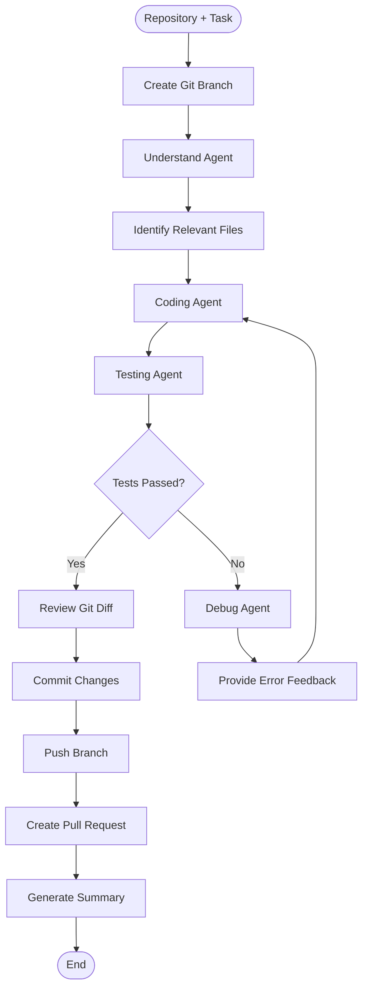

# Autonomous Software Engineering Agent (SWE-Agent)

An AI-powered, multi-agent software engineering system built with **Python, LangGraph, and LLMs** that automates code analysis, bug fixing, testing, debugging, and GitHub workflows.

The agent accepts a GitHub repository and a development task, analyzes relevant code, generates modifications, executes tests, and iteratively attempts to fix failures. Once validation succeeds, it can create a Git branch, commit and push changes, and open a pull request for review.

## System Architecture

The system uses a stateful LangGraph workflow to coordinate specialized agents and manage iterative self-correction.



## Key Features

- **Multi-Agent Architecture:** Specialized Understand, Coding, Testing, and Debug agents handle different stages of software development.
- **Codebase Analysis:** Identifies relevant files and gathers context for a given task.
- **Automated Code Generation:** Produces code modifications based on task requirements and existing code.
- **Automated Testing:** Runs configured tests and captures execution results.
- **Self-Correction Loop:** Uses debugging feedback to guide subsequent coding attempts when tests fail.
- **Git Automation:** Creates dedicated branches, reviews changes, commits modifications, and pushes updates.
- **GitHub Integration:** Automates pull request creation for review.
- **Shared State Management:** Maintains task context, analysis, debugging feedback, test results, and execution attempts.
- **Docker-Based Execution:** Runs code and tests in a configured containerized environment.

## Technology Stack

| Technology | Purpose |
|---|---|
| Python | Core application and agent implementation |
| LangGraph | Workflow orchestration, state management, and conditional routing |
| LangChain | LLM integration and agent components |
| LLM APIs | Code understanding, generation, and debugging |
| Git | Branching, commits, and version control |
| GitHub API | Repository operations and pull request creation |
| Docker | Containerized code execution and testing |

## Project Structure

```text
autonomous-swe-agent/
├── agents/
│   ├── coding_agent.py
│   ├── debug_agent.py
│   ├── file_selector.py
│   ├── testing_agent.py
│   └── understand_agent.py
├── backend/
│   ├── graph.py
│   ├── llm.py
│   └── main.py
├── tests/
├── tools/
│   ├── file_tools.py
│   ├── git_tools.py
│   ├── repo.py
│   └── test_tools.py
├── workspace/
├── Dockerfile
├── requirements.txt
├── .env
├── .gitignore
└── README.md
```

## Getting Started

### Prerequisites

- Python 3.10+ (use the version supported by your dependencies)
- Git
- Docker
- A GitHub account and an appropriately scoped access token
- API credentials for the configured LLM provider

### 1. Clone the Repository

```bash
git clone https://github.com/astroophilliiiiiiiii/Autonomous-swe-agent.git
cd Autonomous-swe-agent
```

### 2. Create a Virtual Environment

```bash
python -m venv venv
```

Activate it on Windows:

```powershell
.\venv\Scripts\Activate.ps1
```

Activate it on macOS/Linux:

```bash
source venv/bin/activate
```

### 3. Install Dependencies

```bash
pip install -r requirements.txt
```

### 4. Configure Environment Variables

Create a `.env` file in the project root and configure the variables required by your implementation.

For example:

```env
OPENAI_API_KEY=your_llm_api_key
GITHUB_TOKEN=your_github_token
REPO_OWNER=your_github_username
REPO_NAME=your_target_repository
```

Use the exact environment variable names expected by your code. Never commit real API keys or tokens to GitHub.

### 5. Run the Agent

From the project root, with the virtual environment activated:

```bash
python -m backend.main
```

Follow the prompts to provide the GitHub repository and the task you want the agent to perform.

## Example Use Case

**Task:** Fix a login validation bug in a repository.

The agent's workflow:

1. Creates a dedicated branch for the task.
2. Analyzes the task and relevant repository files.
3. Generates a code modification.
4. Executes the configured tests.
5. If tests fail, analyzes the errors and attempts a correction.
6. Reviews the resulting changes.
7. Commits and pushes validated changes.
8. Creates a pull request and generates a final summary.

Actual results depend on the repository, test coverage, model capabilities, and execution configuration.

## Example Output

An illustrative example of the kind of summary the agent can produce:

```text
Task completed

Branch: swe-agent/fix-login-validation
Commit: Fix login validation
Tests: Passed
Pull Request: <created-pull-request-url>

Change Summary:
- Updated login validation logic
- Addressed the reported issue
- Validated changes with tests
```

The branch name, test results, and pull request URL above are examples, not results from a specific execution.

## Execution Safety

The project uses Docker-based execution to help isolate repository code and tests from the host environment.

Execution safety depends on the container configuration, including permissions, filesystem mounts, network access, resource limits, and secret handling. Avoid exposing sensitive credentials or privileged host resources to untrusted code.

## Engineering Challenges

- Maintaining consistent state across multiple agents.
- Selecting relevant files from an unfamiliar codebase.
- Converting test failures into actionable debugging feedback.
- Controlling retries and tool execution.
- Handling Git operations and GitHub API errors.
- Executing repository code in a controlled environment.
- Producing reviewable changes that can be inspected before integration.

## Future Enhancements

- **CI/CD Integration:** Add automated build and test workflows using GitHub Actions.
- **Human Approval Gates:** Require approval before sensitive operations.
- **Observability:** Add structured logs, execution traces, and performance metrics.
- **Deployment Automation:** Extend the workflow to controlled deployments.
- **Monitoring and Rollback:** Detect failures and support recovery.
- **Evaluation Framework:** Measure task success rate, test pass rate, retries, latency, and cost.

## Project Goals

This project explores the practical use of Agentic AI in software engineering by combining multi-agent collaboration, LLM-powered code generation, workflow orchestration, automated testing, iterative debugging, and GitHub automation.

The objective is to create a structured development workflow in which AI-generated changes are tested and made available for review.

## License

Add an appropriate open-source license if you intend to distribute the project under one.

---

**Built with Python, LangGraph, LangChain, Git, GitHub, and Docker.**
