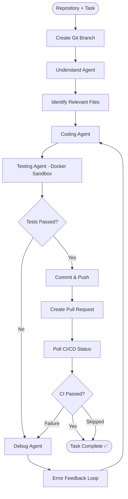

# Autonomous Software Engineering Agent

An AI-powered, multi-agent system that automates end-to-end software engineering workflows — from code analysis and bug fixing to testing, debugging, and GitHub pull request creation.

**Tech Stack:** Python · LangGraph · LangChain · Groq LLM (Llama-3) · Docker · Pytest · Git · GitHub REST API

---

## System Architecture



## Key Features

- **Multi-Agent Architecture** — Specialized Understand, Coding, Testing, and Debug agents handle different stages of software development.
- **Self-Healing Debug Loop** — Automatically analyzes pytest error traces and iteratively fixes failures without human intervention.
- **Robust JSON Extraction** — Multi-strategy parser (json.loads → regex fallback → json_repair) handles malformed LLM output including unescaped quotes.
- **Docker-Based Test Execution** — Runs repository tests in isolated containers with automatic dependency installation.
- **Git & GitHub Automation** — Branch creation, commits, pushes, PR creation, and existing PR updates via GitHub REST API.
- **CI/CD Polling** — Monitors GitHub Actions workflow status and feeds CI failure logs back into the debug loop.
- **Structured Error Handling** — Clear, formatted error messages for rate limits, token overflows, auth failures, and API errors.
- **Benchmarking Suite** — Automated evaluation framework to measure task success rate, test pass rate, self-healing rate, and execution time across multiple repositories.

## Project Structure

```
autonomous-swe-agent/
├── agents/
│   ├── coding_agent.py        # Generates code modifications as JSON
│   ├── debug_agent.py         # Analyzes test failures and suggests fixes
│   ├── file_selector.py       # Identifies relevant files for a task
│   ├── testing_agent.py       # Executes pytest in Docker or host
│   └── understand_agent.py    # Analyzes codebase and task requirements
├── backend/
│   ├── graph.py               # LangGraph workflow with state machine
│   ├── llm.py                 # LLM provider configuration
│   ├── main.py                # CLI entry point
│   └── error_handler.py       # Structured error formatting
├── benchmark/
│   ├── tasks.json             # Evaluation task definitions
│   ├── runner.py              # Automated benchmark execution
│   └── report.py              # Metrics calculation and report generation
├── tests/                     # Unit tests for the agent itself
├── tools/
│   ├── file_tools.py          # File read/write operations
│   ├── git_tools.py           # Git and GitHub API operations
│   ├── repo.py                # Repository cloning and management
│   └── test_tools.py          # Docker/host test execution
├── Dockerfile
├── requirements.txt
├── pytest.ini
└── .env                       # API keys (not committed)
```

## Getting Started

### Prerequisites

- Python 3.10+
- Git
- Docker (optional, for sandboxed test execution)
- Groq API key
- GitHub Personal Access Token

### Setup

```bash
git clone https://github.com/astroophilliiiiiiiii/Autonomous-swe-agent.git
cd Autonomous-swe-agent
python -m venv venv
# Windows: .\venv\Scripts\Activate.ps1
# Linux/macOS: source venv/bin/activate
pip install -r requirements.txt
```

Create a `.env` file:

```env
GROQ_API_KEY=your_groq_api_key
GITHUB_TOKEN=your_github_token
```

### Run the Agent

```bash
python -m backend.main
```

Follow the prompts to provide a GitHub repository URL and task description.

### Run Benchmarks

```bash
# Run all evaluation tasks
python -m benchmark.runner

# Run tasks for a specific repo
python -m benchmark.runner --repo simple_calculator

# Generate metrics report
python -m benchmark.report
```

### Run Unit Tests

```bash
pytest tests/ -v
```

## Example Workflow

**Input:**
```
GitHub Repository: https://github.com/user/calculator.git
Task: Add a factorial method to the Calculator class with unit tests.
```

**What the agent does:**
1. Clones the repository and creates a feature branch
2. Analyzes the codebase to understand the existing structure
3. Generates code changes and new test files
4. Runs the full pytest suite in a Docker sandbox
5. If tests fail → Debug agent analyzes errors → Coding agent fixes → Re-test
6. Commits, pushes, and creates a GitHub pull request
7. Polls GitHub Actions CI and reports final status

## License

MIT

---

**Built with Python, LangGraph, LangChain, Groq, Docker, and GitHub.**
